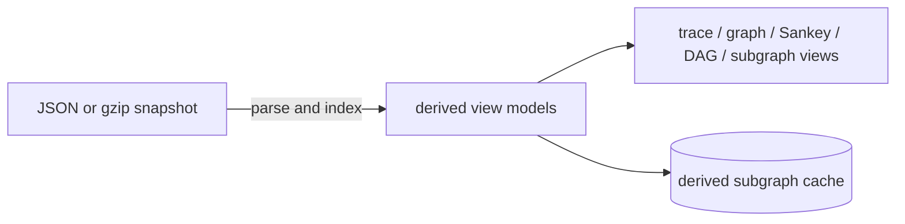

# Creature compaction audit (Issue #680)

## Context

The parent, stSoftwareAU/NEAT-AI-core#775, unifies creature compaction across
the NEAT-AI family in a single shared Rust implementation. Its rollout contract
says repositories that do not compact must not take on new runtime compaction;
they are audited for compatibility only. Explore is stage 4J.

## Verdict

Explore is a read-only snapshot viewer. It has no whole-creature compaction,
pruning or simplification of a creature, and no creature export path. Its
reductions build display models, not executable creatures. There is nothing to
migrate, and no NEAT-AI/core dependency is added.

## Evidence

Line numbers were checked against the source at the time of the audit.

| Path inspected                                                                                                      | Finding                                                                                                                                                                                                                                                                                                                                                                  |
| ------------------------------------------------------------------------------------------------------------------- | ------------------------------------------------------------------------------------------------------------------------------------------------------------------------------------------------------------------------------------------------------------------------------------------------------------------------------------------------------------------------ |
| `docs/shared/snapshot_loader.js:159`, `:293`, `:342`                                                                | `fetchSnapshotJson`, `normaliseCreature` and `readSnapshotFile` parse JSON or gzip. `normaliseCreature` retains the original `creature` / `creatureJson`, indexes raw neurons, synthesises inputs in that separate index, and copies valid synapses into normalised records. It does not replace the creature arrays.                                                    |
| `docs/app.js:884`, `:892`, `docs/graph/graph.js:3687`                                                               | The `normaliseCreature` wrapper and `loadSnapshot` in the app, and `loadSnapshot` in the graph, install indexes and compute diagnostics, adjacency and renderer buffers. `annotateEdgeStatsFromDerived` (`graph.js:714`) annotates newly created adjacency edge records. `docs/starfield/starfield.js:18` imports the Graph implementation. No topology edit is applied. |
| `docs/shared/creature_overview.js:155`                                                                              | `computeLayerTopology` groups UUIDs into overview layers and edge summaries rather than rewriting a genome.                                                                                                                                                                                                                                                              |
| `docs/shared/aggregated_graph_model.js:233`                                                                         | `buildAggregatedGraphModel` aggregates families, low-impact hidden nodes and parallel edges into new display nodes and edges. No reduced creature is installed.                                                                                                                                                                                                          |
| `docs/shared/subgraph_model.js:254`                                                                                 | `extractTopImpactSubgraph` filters ranked paths, copies kept nodes and renumbers their display layers densely (lines 287-301). `docs/subgraph/subgraph.js:322` calls it and `:340` lays out the result.                                                                                                                                                                  |
| `docs/shared/sankey_flow.js:81`                                                                                     | `foldLowRankNodes` folds weak nodes and merges remapped edges into new records. `buildSankeyFlow` assigns display flow; its caller at `docs/sankey/sankey.js:637` renders the result.                                                                                                                                                                                    |
| `docs/shared/dag_layout.js:319`                                                                                     | `computeDagLayout` builds layout nodes and merged edges; `docs/dag/dag.js:188` renders them. Neither this nor Sankey converts its reduced model back into a creature.                                                                                                                                                                                                    |
| `docs/shared/discovery.js:19`, `:140`, `docs/app.js:3851`, `:3930`                                                  | `normaliseCandidate` and `extractDiscoveryCandidates` normalise candidates; `renderCandidatesPanel` and `renderSplitSynapseCandidateDetail` show them. Proposed split edges and count changes are SVG/text, not applied edits. Raw JSON is escaped display text (`app.js:4021`).                                                                                         |
| `docs/shared/candidate_views.js`, `docs/compare/compare.js`                                                         | Comparison "candidates" are alternative visualisations. Launcher cards propagate the same snapshot URL, not competing edited creatures.                                                                                                                                                                                                                                  |
| `docs/app.js:809`, `docs/sw.js:254`                                                                                 | Cache Storage stores cloned HTTP responses. The app temporarily annotates parsed snapshots with a cache-status Symbol (`app.js:700`, `:706`, removed at `:902`); this does not edit creature metadata.                                                                                                                                                                   |
| `docs/shared/subgraph_derivation.js:48`, `docs/subgraph/subgraph_worker.js:39`, `docs/shared/subgraph_cache.js:153` | URL/file derivation produces rankings and tooltips, transported by worker messages and stored as a schema-tagged derived result in IndexedDB. This is local display persistence, not creature export.                                                                                                                                                                    |

**Broader search and sink review:** `git grep` across tracked `docs/`,
`scripts/` and `helpers/` covered compaction, pruning and simplification, neuron
and synapse assignments, weight, bias, UUID and score writes, array mutations,
serialisation, file and download APIs, HTTP write methods, worker messages and
browser storage. The application's "compact" hits describe navigation,
formatting or layout. No creature export sink was found. App-owned `Blob` use
decodes gzip; vendored `docs/vendor/fflate.browser.js:12` also creates worker
Blobs and object URLs. Script file writes produce PNG/ICO assets, SBOM JSON,
build stamps and evidence HTML. Local storage writes hold UI preferences and
recovery state.

**Dependencies and score semantics:** `deno.json` imports Astral, deno-dom,
standard-library utilities and Playwright only; `grep -c stsoftware deno.lock`
prints 0. No NEAT-AI/core compaction dependency is resolved. Aggregate impacts
use recorded values or viewer attribution; Sankey's `totalScore` sums output
impact, and subgraph scores are normalised attribution shares. These quantities
do not accept a candidate or replace an incumbent's fitness, tags or UUID.

## Re-audit trigger

If Explore ever adds a path that rewrites, compacts or exports a creature, it
must call the released shared Rust core API (or the released NEAT-AI TypeScript
adapter, stSoftwareAU/NEAT-AI#4196) instead of re-implementing compaction. Pin
only merged and released versions, never an unmerged branch. As of 2026-11-26,
stSoftwareAU/NEAT-AI-core#779 and stSoftwareAU/NEAT-AI#4196 are still open.
