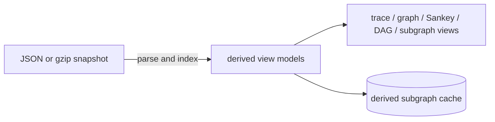

# PR Summary — Issue #680: compaction migration audit

## Summary

Audited snapshot loading, discovery candidates, the exploration views,
persistence and export for whole-creature compaction or equivalent structural
creature rewrites. None exists. Explore is a read-only viewer whose reductions
build display models, and it has no creature export path. As #680 asks when no
duplicate exists, this PR records the evidence and adds no code or dependency:

- `docs/archive/compaction-audit-680.md` holds the audit.
- `README.md` (Related Repositories) gets one paragraph stating the outcome and
  linking the audit.

Closes #680.

## Spec

### Intent and Rationale

- Parent stSoftwareAU/NEAT-AI-core#775 says repositories that do not compact
  must not take on new runtime compaction and are audited for compatibility
  only. Adding a core dependency or compaction call here would break that.
- The audit is a committed record rather than PR-body prose only, following the
  `docs/archive/candidate-view-evaluation-528.md` precedent.

### Essential Design Decisions

- Normalisation and visual aggregation (aggregated model, Sankey fold, DAG
  layout, subgraph extraction) stay separate from creature rewriting. Their
  outputs are display nodes and edges, never an executable creature.
- No NEAT-AI/core pin is added. Any future path that rewrites, compacts or
  exports a creature must call the merged and released shared API. The audit's
  "Re-audit trigger" section says so.

### Undiscoverable Facts

- `gh issue view` on 2026-11-26 shows stSoftwareAU/NEAT-AI-core#779 and
  stSoftwareAU/NEAT-AI#4196 still OPEN. This audit adopts no artefact from
  either, so their release gates do not block it.

## Evidence

Documentation-only change (no UI, script or test files). I read every
`file:line` cited in the audit table at the head and corrected the stale line
numbers from the earlier checkpoint. I dropped claims I could not confirm.
`grep -c stsoftware deno.lock` prints `0`, and the `deno.json` imports are only
Astral, deno-dom, `@std/*` and Playwright.

## Test Plan

No tests added, removed or modified, because no production behaviour changes.
`timeout 900 ./quality.sh < /dev/null` ran on the head commit `8d46272` and
passed. It ended with `ok | 1241 passed (70 steps) | 0 failed` and `==> OK`.
Format, lint and type checks were clean. These include the existing snapshot,
normalisation, discovery, aggregated-model, Sankey, DAG and subgraph tests,
which cover serialised-creature compatibility.

## Merge verification

PR CI and code review are pending.

Not checked: shared API package contents, scorer parity and compaction
benchmarks, because no API or release artefact is adopted. Browser rendering is
unaffected by this documentation-only diff and was not checked. Remaining risk:
a future creature-rewriting path would need a fresh audit against the released
API.

🤖 Generated with [Claude Code](https://claude.com/claude-code)
