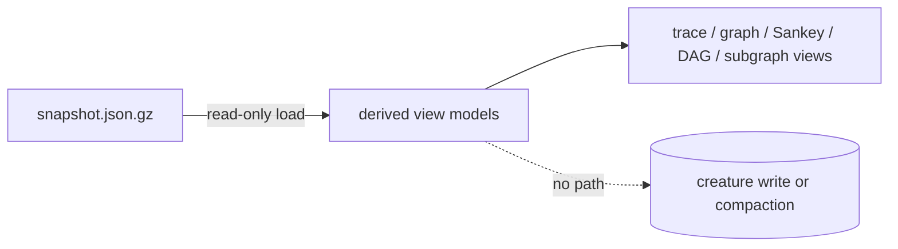

# PR Summary — Issue #680: compaction migration audit

## Summary

Audit only, no code change. The issue asks for every existing whole-creature
compaction, and every duplicated equivalent structural rewrite, in exploration,
candidate edits and export to move onto the shared Rust compaction API. NEAT-AI
Explore has none of these. It is a static, read-only viewer: it loads a
snapshot, derives display models from it, and never edits, compacts or writes a
creature back. The issue says "if no duplicate exists, record evidence and close
with no unnecessary code", so this PR is that record. Closes #680.

## Spec

### Intent and Rationale

- The parent (stSoftwareAU/NEAT-AI-core#775) wants every family consumer that
  compacts to call one Rust engine. A consumer that never compacts has nothing
  to switch over, and the issue forbids adding compaction to read-only paths.

### Essential Design Decisions

- I added no dependency on NEAT-AI or NEAT-AI-core, and no compaction call.
  Every audited path is read-only, which the issue rules out ("Do not add new
  compaction calls to read-only or previously uncompacted paths").
- The view-model reductions listed below are not candidates for the shared
  engine. They act on a derived display model, not on the creature, and they do
  not preserve outputs. The engine applies output-preserving rewrites to the
  creature itself.

### Undiscoverable Facts

- The issue depends on stSoftwareAU/NEAT-AI-core#779 and
  stSoftwareAU/NEAT-AI#4196, and both were still OPEN on 2026-11-26 (checked
  with `gh issue view`). Neither is needed here, because no caller would use the
  API they publish.

## Evidence

This is a backend audit with no UI change. These are the searches I ran over the
head of `Develop` (`98376b4`):

- **Dependencies:** `deno.json` imports only `@astral/astral`,
  `@b-fuze/deno-dom`, `@std/http`, `@std/path`, `@std/yaml` and `playwright`.
  There is no NEAT-AI, NEAT-AI-core or WASM package, and `deno.lock` has no
  `stsoftware` entry. The only `@stsoftware*` names are the
  `minimumDependencyAge.exclude` globs.
- **"compact" in the app code** (`grep -rniE compact` over `docs/`): every hit
  is UI wording. It covers the phone trace nav (`initCompactTraceNav`,
  `docs/app.js:367`), percentage formatting (`docs/shared/trace_score.js:17`,
  `docs/shared/observation_contributions.js:100`) and a layout comment
  (`docs/graph/graph.js:1391`).
- **Subgraph layer renumbering** (`docs/shared/subgraph_model.js:287`). This
  maps the display columns that remain after path filtering onto dense indices,
  in a copied view model. The creature is not touched.
- **Sankey and DAG folding** (`foldLowRankNodes`,
  `docs/shared/sankey_flow.js:81`; `docs/shared/dag_layout.js:362`). These fold
  low-impact display nodes into a per-layer "other" aggregate so the drawing
  stays legible. That is a lossy visual aggregation, not an output-preserving
  creature rewrite.
- **Candidate edits:** candidate code (`docs/shared/discovery.js`
  `normaliseCandidate` / `extractDiscoveryCandidates`,
  `docs/shared/candidate_views.js`, `docs/compare/compare.js`) normalises and
  displays the candidates a snapshot records. It does not edit them.
- **Export:** searches for `new Blob`, `createObjectURL`, `.download =`,
  `showSaveFilePicker` and `writeTextFile`/`writeFile` find no creature output.
  The single `Blob` is the gzip decode in `docs/shared/snapshot_loader.js:108`.
  The single `JSON.stringify` renders the raw candidate JSON as escaped text
  (`docs/app.js:4021`). Script writes produce PNGs, the SBOM, the build-id stamp
  and evidence HTML.
- **Mutation:** no `.neurons` / `.synapses` assignment, splice, push or `delete`
  appears anywhere in `docs/`, `scripts/` or `helpers/`.

## Test Plan

- I changed no test and no production file.
- `./quality.sh < /dev/null` on the head:
  `ok | 1241 passed (70 steps) | 0 failed`, `==> OK`.
- Serialised-creature compatibility and score semantics are unchanged, because
  nothing in the diff reads or writes a creature.

Not checked: none. Remaining risk: if a later change adds creature editing or
export, it would need to call the shared engine once #779 / #4196 are released.

🤖 Generated with [Claude Code](https://claude.com/claude-code)
