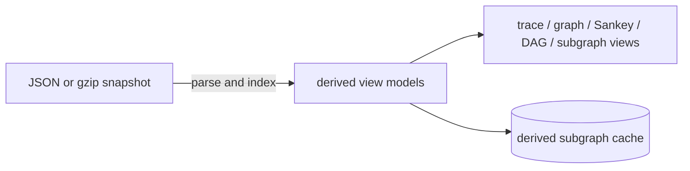

# PR Summary — Issue #680: compaction migration audit

## Summary

Recorded the audit of snapshot loading, candidate handling, exploration and
export. No whole-creature compaction caller or equivalent creature rewrite was
found. The reductions inspected produce display models. This audit adds no
production code, tests or runtime dependency. Closes #680.

## Spec

### Intent and Rationale

- Preserve the audit-only outcome allowed by #680 and parent
  stSoftwareAU/NEAT-AI-core#775 when a consumer does not compact. Adding
  compaction to these previously uncompacted paths would violate the scope.

### Essential Design Decisions

- Keep schema normalisation and visual aggregation separate from creature
  rewriting: the derived nodes/edges are not an executable creature.
- Add no NEAT-AI/core dependency. A future migration of an existing compaction
  caller must first verify the compatible merged and released core API (and
  TypeScript adapter where required); do not pin an unmerged branch.

### Undiscoverable Facts

- On 2026-11-26, `gh issue view` independently confirmed that
  stSoftwareAU/NEAT-AI-core#779 (publish the native/WASM API) and
  stSoftwareAU/NEAT-AI#4196 (switch TypeScript callers) remain OPEN. No release
  artefact is adopted by this audit, so their release gates do not block it.

## Evidence

The audit continues checkpoint `8a05624`, whose sole difference from
`origin/Develop` (`98376b4`) is this record. Source reads and caller tracing
independently verify the findings below. No UI files change.

- [x] Verify snapshot and candidate handling.
- [x] Trace display reductions, exploration, persistence and export sinks.
- [x] Re-run targeted compatibility tests (167 passed).
- [x] Re-run the bounded foreground quality gate (1,241 passed).

| Path inspected                                                                                                      | Finding                                                                                                                                                                                                                                                                                                          |
| ------------------------------------------------------------------------------------------------------------------- | ---------------------------------------------------------------------------------------------------------------------------------------------------------------------------------------------------------------------------------------------------------------------------------------------------------------- |
| `docs/shared/snapshot_loader.js:159`, `:293`, `:342`                                                                | Fetch/upload parses JSON or gzip. `normaliseCreature` retains the original `creature` / `creatureJson`, indexes raw neurons, synthesises inputs in that separate index, and copies valid synapses into normalised records. It does not replace the creature arrays. Raw neuron objects remain shared references. |
| `docs/app.js:884`, `docs/graph/graph.js:3687`                                                                       | Loaders install indexes and compute diagnostics, adjacency and renderer buffers. `annotateEdgeStatsFromDerived` at graph line 714 annotates newly created adjacency edge records. `docs/starfield/starfield.js:18` imports the Graph implementation. No topology edit is applied.                                |
| `docs/shared/creature_overview.js:154`                                                                              | `computeLayerTopology` groups UUIDs into overview layers and edge summaries rather than rewriting a genome.                                                                                                                                                                                                      |
| `docs/shared/aggregated_graph_model.js:233`                                                                         | Output reachability filters local UUID/synapse lists; families, low-impact hidden nodes and parallel edges aggregate into new display nodes/edges. Excluded neurons/internal edges are counted. No reduced creature is installed.                                                                                |
| `docs/shared/subgraph_model.js:254`                                                                                 | `extractTopImpactSubgraph` filters ranked paths, copies kept nodes and renumbers their display layers densely (line 287). Filtered edges/families may remain shared with the source model; this is not a deep clone. `docs/subgraph/subgraph.js:322` renders through DAG layout/SVG.                             |
| `docs/shared/sankey_flow.js:81`                                                                                     | `foldLowRankNodes` copies retained nodes/members, folds weak nodes and merges remapped edges into new records. `buildSankeyFlow` assigns display flow; its caller at `docs/sankey/sankey.js:630` renders the result.                                                                                             |
| `docs/shared/dag_layout.js:319`                                                                                     | `computeDagLayout` sorts/splices its own column arrays, folds overflow and builds layout nodes and merged edges. `docs/dag/dag.js:187` renders SVG. Neither this nor Sankey converts its reduced model back into a creature.                                                                                     |
| `docs/shared/discovery.js:19`, `:140`, `docs/app.js:3851`, `:3930`                                                  | Candidates are normalised, indexed and selected for inspection. Proposed split edges/count changes are SVG/text, not applied edits. Expected gains retain their sign; `raw` retains the original candidate. Raw JSON is escaped display text at app line 4021.                                                   |
| `docs/shared/candidate_views.js`, `docs/compare/compare.js`                                                         | Comparison “candidates” are alternative visualisations. Launcher cards propagate the same snapshot URL, not competing edited creatures.                                                                                                                                                                          |
| `docs/app.js:809`, `docs/sw.js:254`                                                                                 | Cache Storage stores cloned HTTP responses. The app temporarily annotates parsed snapshots with a cache-status Symbol (line 707, removed at line 902); this does not edit creature metadata.                                                                                                                     |
| `docs/shared/subgraph_derivation.js:48`, `docs/subgraph/subgraph_worker.js:39`, `docs/shared/subgraph_cache.js:153` | URL/file derivation produces rankings and tooltips, transported by worker messages and stored as a schema-tagged derived result in IndexedDB. This is local display persistence, not creature export.                                                                                                            |

**Broader search and sink review:** `git grep` across tracked `docs/`,
`scripts/` and `helpers/` covered compaction/pruning/simplification, neuron and
synapse assignments, weight/bias/UUID/score writes, array mutations,
serialisation, file/download APIs, HTTP write methods, worker messages and
browser storage. The application’s “compact” hits describe navigation,
formatting or layout. No creature export sink was found. App-owned `Blob` use
decodes gzip; vendored `docs/vendor/fflate.browser.js:12` also creates worker
Blobs/object URLs. Script file writes produce PNG/ICO assets, SBOM JSON, build
stamps and evidence HTML. Local storage writes hold UI preferences/recovery
state.

**Dependencies and score semantics:** `deno.json` imports Astral, deno-dom,
standard-library utilities and Playwright; `deno.lock` has no `stsoftware`
entry. No NEAT-AI/core compaction dependency is resolved. Aggregate impacts use
recorded values or viewer attribution; Sankey’s `totalScore` sums output impact,
and subgraph scores are normalised attribution shares. These quantities do not
accept a candidate or replace an incumbent’s fitness, tags or UUID. No persisted
shape, serialisation or score rule changes in this diff.

## Test Plan

No tests added, removed or modified: no production change proved necessary. The
following existing files were run together with
`timeout 180 deno test -A --reporter=dot`, stdin from `/dev/null`: **167 passed,
0 failed**.

| Existing tests                                                                                                 | Relevant compatibility evidence                                                                                                                                     |
| -------------------------------------------------------------------------------------------------------------- | ------------------------------------------------------------------------------------------------------------------------------------------------------------------- |
| `tests/snapshot_loader_test.ts`, `tests/snapshot_loader_fetch_test.ts`, `tests/snapshot_loader_gunzip_test.ts` | URL handling, HTTP failure/retry, plain/gzip JSON; `readSnapshotFile parses plain JSON file` and `readSnapshotFile parses gzipped JSON file` check parsed metadata. |
| `tests/normalise_creature_test.ts`                                                                             | Creature aliases, synapse UUID variants, invalid synapses; `normaliseCreature does not overwrite existing input neurons` checks the existing squash.                |
| `tests/discovery_test.ts`                                                                                      | Signed gains, schema aliases, non-finite fields and `normaliseCandidate preserves raw reference`.                                                                   |
| `tests/candidate_comparison_test.ts`                                                                           | Snapshot URL round-trip and shared-fixture view-model compatibility.                                                                                                |
| `tests/aggregated_graph_model_test.ts`, `tests/subgraph_view_test.ts`, `tests/subgraph_cache_test.ts`          | Reachability, grouping, path shares, multi-output attribution, worker pipeline and cache invalidation.                                                              |
| `tests/sankey_view_test.ts`, `tests/dag_view_test.ts`                                                          | Flow conservation before/after folding, remapped edges and deterministic display layout.                                                                            |

Fresh `timeout 1200 ./quality.sh < /dev/null`: **passed**, ending with
`ok | 1241 passed (70 steps) | 0 failed` and `==> OK`. Bash syntax, ShellCheck,
format, lint and type checks passed. Deno remained at 2.9.8: the gate’s
best-effort self-upgrade reported no write permission to `/usr/local/bin/deno`
and continued as designed. This result revalidates the checkpoint’s historical
gate claim.

## Merge verification

PR CI and subsequent code review have not been observed in this executor pass.

Not checked: shared API package contents, downstream family CI, scorer parity
and compaction benchmarks, because no API or release artefact is adopted.
Browser rendering was not checked for this documentation-only diff. Remaining
risk: future compaction callers need a new audit and compatible merged/released
API before cutover.
